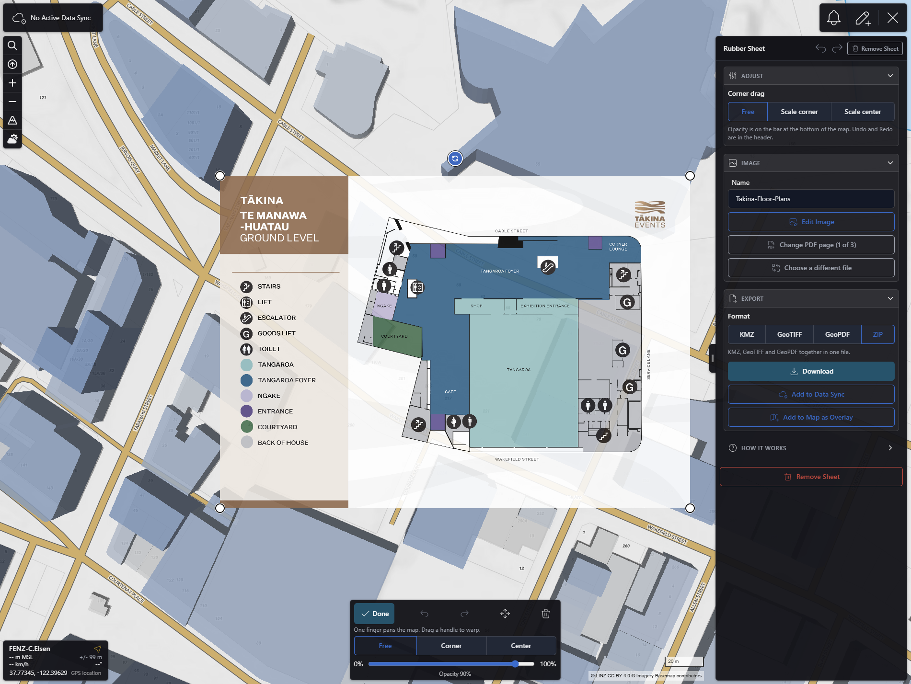
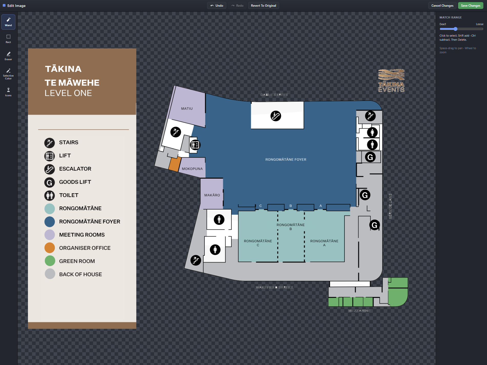

# Rubber Sheet

CloudTAK plugin that stretches an image or PDF over the map, the way ATAK rubber-sheets a floor plan onto a building.

## What it does
* Open **Rubber Sheet** from the menu and choose a PNG, JPEG, WebP, GIF, or PDF (a multi-page PDF shows a page picker). The sheet is placed north-up in the middle of the view.
* **Warp it** by dragging a corner handle; the round handle rotates. Drag the image to move it (on touch, turn on **Move** first). With a keyboard, hold Shift to scale about the opposite corner or Alt to scale from the center; without one, use **Corner drag** in the pane (Free, Scale corner, Scale center). Undo and Redo are in the pane header and on Ctrl/Cmd+Z and Ctrl+Y.
* **Adjust bar** at the bottom of the map: **Done** (hides the handles so you can pan the map; **Adjust** brings them back), Undo, Redo, Move, **Remove Sheet** and the opacity slider. On a desktop with a mouse only the slider shows. When another plugin opens a bottom panel (for example Weather) the bar steps aside until that panel closes. The plugins tell each other through the `cloudtak-plugin:panel-open` and `cloudtak-plugin:panel-close` events on `window`; the contract is in [`docs/fork/PLUGIN-PANELS.md`](https://github.com/TAK-NZ/CloudTAK/blob/main/docs/fork/PLUGIN-PANELS.md) of the TAK-NZ CloudTAK fork, and the shared helper is `lib/panel-coordinator.ts` (MIT-0).
* **Edit Image** opens a fullscreen editor with Hand, magic wand, rectangle marquee, eraser, Selective Color and facility **Icons** (first aid, AED, hydrant, shutoffs, hazmat, numbered placards and more). Replace / Add / Subtract controls how selections combine. It works with a mouse or touch (one finger uses the tool, two fingers pan and zoom). **Revert To Original** restores the unedited image, **Save** keeps your map corners, and Back asks before discarding unsaved edits.
* Pick a **Format** (KMZ, GeoTIFF, GeoPDF, or a ZIP of all three), then **Download**, **Add to Data Sync** (data syncs you are subscribed to with write access) or **Add to Map as Overlay** (imported like Files → Add to Map as Overlay).
* KMZ keeps the exact four corners (`gx:LatLonQuad`). GeoTIFF and GeoPDF are north-up copies of the fitted sheet, as those formats cannot store a warp. Images are JPEG quality 85, and pictures with transparency stay PNG in the KMZ.
* On phones images are capped at 2048 px and the editor keeps 10 undo steps (desktop: 4096 px, 40). The layout follows the CloudTAK theme (Light and Dark).
* Desktop keyboard shortcuts in the editor: Space-drag or wheel to pan and zoom, `[` and `]` for brush size, Delete to clear a selection, Ctrl/Cmd+D or Esc to deselect.

## Screenshots

The Rubber Sheet panel with a PDF floor plan placed on the map. The sheet is warped by dragging its corners, and the opacity slider sits at the bottom of the map.



Edit Image opens the fullscreen pixel editor, with the wand, rectangle marquee, eraser, Selective Color and facility icon tools.



## Requirements

CloudTAK **13.102** or newer. PDF pages are rendered with [PDF.js](https://github.com/mozilla/pdf.js) (Apache-2.0), so the CloudTAK app must have `pdfjs-dist` **4.10.38** as a dependency for the web build to bundle it. `WEB_PLUGINS` only clones the plugin and does not install dependencies.

## Install

The plugin is compiled into the CloudTAK web bundle when the CloudTAK image is built. Nothing is installed at runtime.

1. `app/package.json` in [TAK-NZ/CloudTAK](https://github.com/TAK-NZ/CloudTAK) must list `"pdfjs-dist": "4.10.38"` (exact version) and `app/package-lock.json` must match. The Docker build runs `npm ci` before plugins are cloned, so the plugin cannot add it itself.
2. List the plugin URL in `webPlugins` for the environment in `cdk/cdk.json` (`context.<env>.cloudtak.webPlugins`). Several plugins can be separated by commas or spaces:
   ```json
   "webPlugins": "https://github.com/TAK-NZ/cloudtak-plugin-rubbersheet.git"
   ```
3. Deploy as usual. See [Installing CloudTAK plugins (WEB_PLUGINS)](https://github.com/TAK-NZ/CloudTAK/blob/main/docs/DEPLOYMENT_GUIDE.md) in the deployment guide for the manual and CI paths.
4. Users choose **Settings → Refresh App**, because the service worker caches the old app.

The build clones the default branch (`main`) with `--depth 1`. A change to this repository alone does not change the image hash, so re-run the image build with `force_rebuild` or change a file under `api/` or `app/`. The image build also runs `npm run lint && npm run check` over `app/plugins/`, so the plugin has to pass the CloudTAK app's lint and type checks.

To remove the plugin, take the URL out of `webPlugins` and rebuild.

## Development

Put a clone at `app/plugins/cloudtak-plugin-rubbersheet` inside a CloudTAK checkout (the folder is git-ignored by CloudTAK), then run `npm ci` and `npm run serve` from `app/`:

```bash
git clone https://github.com/TAK-NZ/cloudtak-plugin-rubbersheet.git /path/to/CloudTAK/app/plugins/cloudtak-plugin-rubbersheet
```

The plugin has to live physically in `app/plugins/<name>/` to run in the app: `lib/overlay.ts`, `lib/missions.ts` and the other host imports use relative paths such as `../../../src/std.ts`. A symlink works for the host's lint and type check but not for running the app.

```bash
npm test    # in this repository: unit tests for the pure logic (geometry, warp, history, viewport maths, export formats)

cd /path/to/CloudTAK/app
npx eslint --config eslint.config.js plugins/cloudtak-plugin-rubbersheet/index.ts plugins/cloudtak-plugin-rubbersheet/lib   # 0 errors expected
npm run check   # vue-tsc for the whole app
```

`npm run lint` in `app/` follows the same rules for a plugin that is a real folder. The image build runs both.

Try it on a phone-sized screen with Chrome DevTools device mode: 360×800, 390×844 and 844×390 (landscape), touch emulation on, in both Light and Dark theme. Real-device checks (finger size, Android Back, iOS safe areas, share sheet, login in the CloudTAK apps, large PDFs) are listed in [docs/testing.md](docs/testing.md).

## Licence

Apache License 2.0. See [LICENSE](LICENSE). The menu icon is traced from an ATAK-CIV icon (GPL-3.0); see [NOTICE](NOTICE). PDF.js is Apache-2.0.
